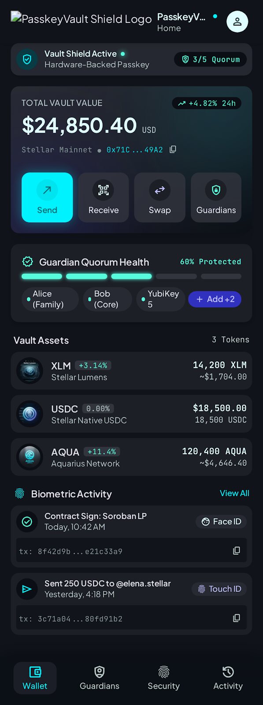
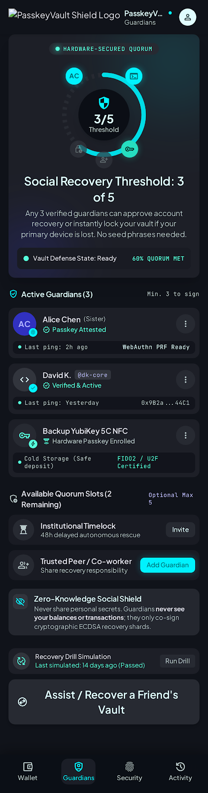
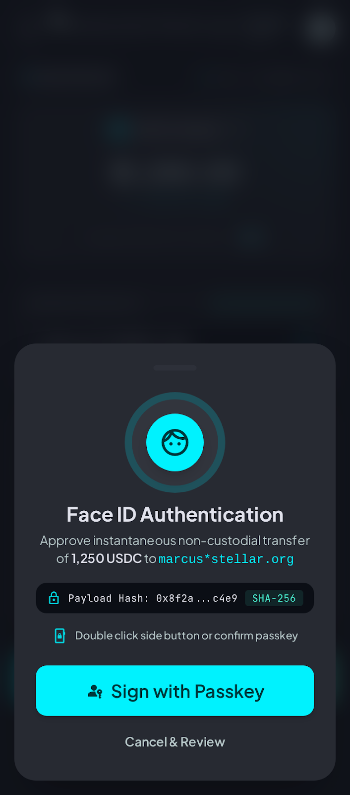

<p align="center"></p>

# PasskeyVault

[](https://github.com/Passkey-vault/Passkey-vault/actions/workflows/ci.yml)
[](#license)
[](https://stellar.expert/explorer/testnet)
[](https://github.com/Passkey-vault/Passkey-vault/labels/good%20first%20issue)

A Stellar smart wallet secured by **passkeys** (Face ID, Touch ID, Windows Hello, YubiKey) instead of seed phrases, with **guardians** who can freeze it in an emergency and recover it if you lose your device.

> **Status: testnet preview.** The contract has **not been audited**. Do not use it with real funds.

<p align="center">
  
  
  
</p>

## How it works

```
 Browser                                    Stellar (Soroban)
 ───────                                    ─────────────────
 navigator.credentials.get()                 passkey-vault contract
   │  challenge = auth payload hash            __check_auth(payload, sig)
   ▼                                             ├─ vault frozen?          → reject
 WebAuthn assertion (P-256 / ES256)              ├─ signer registered?      → else reject
   authenticatorData, clientDataJSON, sig        ├─ UP flag, type=webauthn.get
   │                                             ├─ clientDataJSON.challenge == payload
   ▼                                             └─ secp256r1_verify(pk, sha256(authData‖sha256(cdj)), sig)
 Soroban auth entry ──► fee payer submits tx ──►
```

- **The vault is a contract account** (`C…` address). Any registered passkey can authorize it. Verification uses Soroban's native `secp256r1_verify` host function.
- **Guardians** are any Stellar addresses (`G…` accounts or other vaults). Any guardian can `freeze`. A threshold of guardians can `unfreeze` or `recover` the vault onto a new passkey.
- **Fees** are paid by a throwaway testnet account held in the browser. Passkeys authorize vault actions; the fee payer can't move vault funds. Replacing it with a relayer is on the [roadmap](docs/ROADMAP.md).

## Repository layout

| Path | What |
| --- | --- |
| [`contracts/vault`](contracts/vault) | Soroban contract (Rust): passkey auth, signers, guardians, freeze/unfreeze/recover |
| [`app`](app) | Web app (Vite + React + TypeScript + Tailwind) |
| [`app/e2e`](app/e2e) | End-to-end tests against testnet, using a software P-256 "passkey" |
| [`design/stitch`](design/stitch) | Original screen designs (Google Stitch exports, `screen.png` + `code.html`). Many aren't implemented yet; see the issues. |
| [`docs`](docs) | Roadmap, architecture notes, issue backlog |

## Contract API

| Function | Auth | Description |
| --- | --- | --- |
| `__constructor(key_id, public_key)` | – | Deploy with a first passkey |
| `add_signer(key_id, public_key)` / `remove_signer(key_id)` | vault | Manage passkeys (max 10, can't remove the last) |
| `set_guardians(guardians, threshold)` | vault | Up to 5 guardians, `1 ≤ threshold ≤ n` |
| `freeze(caller)` | vault or a guardian | Reject all vault authorizations |
| `unfreeze(approvers)` | `threshold` guardians | Lift a freeze |
| `recover(approvers, key_id, public_key)` | `threshold` guardians | Replace all signers with one new passkey and unfreeze |
| `signers()`, `guardians()`, `threshold()`, `is_frozen()` | – | Read state |

## Quick start

Requirements: Rust (stable) with the `wasm32v1-none` target, [Stellar CLI](https://developers.stellar.org/docs/tools/cli), Node 22+, pnpm.

```bash
# Contract
cargo test
stellar contract build

# App (uses the wasm already uploaded to testnet, see app/.env.example)
cd app
pnpm install
pnpm dev          # http://localhost:5173
pnpm test         # unit tests
pnpm test:e2e     # deploys a real vault on testnet; needs network access
```

Passkeys need a secure context: `localhost` or HTTPS.

### Deploying your own build of the contract

```bash
stellar keys generate deployer --network testnet --fund
stellar contract upload --wasm target/wasm32v1-none/release/passkey_vault.wasm \
  --source deployer --network testnet
# put the printed hash in app/.env as VITE_VAULT_WASM_HASH
```

## Contributing

Contributions are welcome. Start with [CONTRIBUTING.md](CONTRIBUTING.md), then pick an issue labeled `good first issue`. Larger items are listed in [docs/ROADMAP.md](docs/ROADMAP.md).

Found a security problem? Please follow [SECURITY.md](SECURITY.md). Don't open a public issue for it.

## License

Dual-licensed under [MIT](LICENSE-MIT) or [Apache-2.0](LICENSE-APACHE), at your option.
# Passkey-vault
